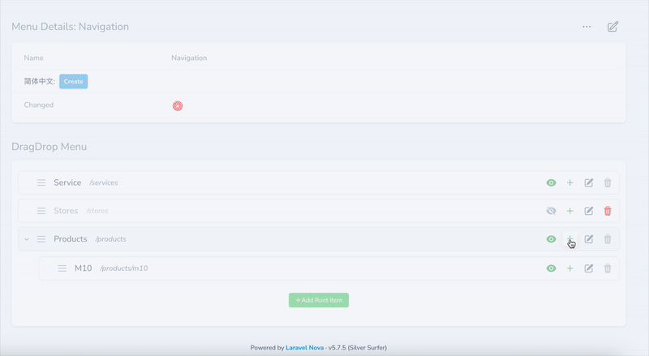

<p align="center"></p>

[中文版本](docs/README_zh.md)

# Laravel Nova Menu

A powerful Laravel Nova 5 package for managing hierarchical menus with drag-and-drop functionality, flexible content support, and multi-language capabilities. Built with Vue.js 3 and modern web technologies.

## Prerequisites

This package requires the following :

- PHP ^8.2
- Laravel 11.x
- Nova ^5.0
- Vue.js 3+

## Features (Client-Oriented)

- 🎯 **Hierarchical Menu Management** - Create unlimited levels of nested menu items
- 🎨 **Drag & Drop Interface**
- 🚀 **Permission Control**
- 🎛️ **UI enhancement** - Not only supports the traditional label+url mode, but also can expand the panel display to achieve rich UI effects

## Features (Developer-Oriented)

- 🚀 Most classes can be customized through the nova-menu.php config file.
- 🔧 **Flexible Content** - Integration with `whitecube/nova-flexible-content` for complex content blocks
- 🔒 Permission can be overwritten

## Installation

1. Install the package via Composer:

```bash
composer config repositories.fayne/laravel-nova-menu '{"type": "git", "url": "git@github.com:Fayne/laravel-nova-menu.git"}' --file composer.json

composer require fayne/laravel-nova-menu
```

2. Publish and run the migrations:

```bash
php artisan vendor:publish --provider="Fayne\Menu\MenuServiceProvider" --tag="migrations"
php artisan migrate
```

3. Publish the configuration file (optional):

```bash
php artisan vendor:publish --provider="Fayne\Menu\MenuServiceProvider" --tag="config"
```

## Configuration

The configuration file allows you to customize various aspects of the menu system

## Headless release menus

This package registers GET /headless/releases/{releaseId}/menus and serves menu projections from the frozen release manifest owned by CMS Core. The shared /headless prefix and middleware are configured in nova-cms.headless; override the menu path with:

~~~env
NOVA_MENU_HEADLESS_RELEASE_MENUS_PATH=releases/{releaseId}/menus
~~~

Running php artisan cms:menu:init adds this environment key to the host .env if it is missing. An existing value is preserved; if .env does not exist, initialization skips the file and reports it.

## Fake data

```shell
php artisan db:seed --class='Fayne\Menu\Database\Seeders\MenuSeeder'
```

## Screenshots



### TODO

- [x] Level limiter
- [x] Menu item配置Flexible layout组件
- [x] helper method for API
- [ ] Record menu version
- [ ] Unit tests

### Testing

```bash
# Run tests
composer test

# Run tests with coverage
composer test-coverage
```

## Contributing

1. Create a feature branch
2. Make your changes
3. Add tests for new functionality
4. Ensure all tests pass
5. Submit a pull request

## License

This package is software licensed under the [Proprietary license](LICENSE.md).
