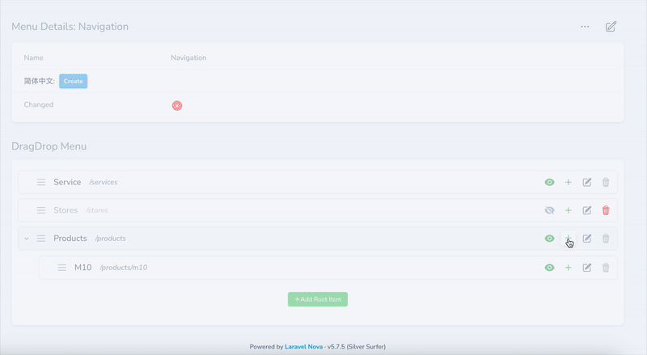

<p align="center"></p>

[English Version](../README.md)

# Laravel Nova Menu

一个强大的 Laravel Nova 5 包，用于管理具有拖放功能的层次菜单，支持灵活内容和多语言功能。使用 Vue.js 3 和现代 Web 技术构建。

## 先决条件

此包需要以下内容：

- PHP ^8.2
- Laravel 11.x
- Nova ^5.0
- Vue.js 3+

## 功能（面向客户）

- 🎯 **层次菜单管理** - 创建无限级嵌套菜单项
- 🎨 **拖放界面**
- 🚀 **权限控制**
- 🎛️ **UI 增强** - 不仅支持传统的标签+URL 模式，还可以扩展面板显示以实现丰富的 UI 效果

## 功能（面向开发）

- 🚀 大多数类可以通过 nova-menu.php 配置文件自定义。
- 🔧 **灵活内容** - 与 `whitecube/nova-flexible-content` 集成，用于复杂内容块
- 🔒 权限可以被覆盖

## 安装

1. 通过 Composer 安装包：

```bash
composer config repositories.fayne/laravel-nova-menu '{"type": "git", "url": "git@github.com:Fayne/laravel-nova-menu.git"}' --file composer.json

composer require fayne/laravel-nova-menu
```

2. 发布并运行迁移：

```bash
php artisan vendor:publish --provider="Fayne\Menu\MenuServiceProvider" --tag="migrations"
php artisan migrate
```

3. 发布配置文件（可选）：

```bash
php artisan vendor:publish --provider="Fayne\Menu\MenuServiceProvider" --tag="config"
```

## 配置

配置文件允许您自定义菜单系统的各个方面

## Headless Release 菜单接口

本包注册 GET /headless/releases/{releaseId}/menus，并从 CMS Core 的冻结 release manifest 读取菜单投影。共享 /headless 前缀和 middleware 配置位于 nova-cms.headless；菜单路径可通过以下环境变量覆盖：

~~~env
NOVA_MENU_HEADLESS_RELEASE_MENUS_PATH=releases/{releaseId}/menus
~~~

运行 php artisan cms:menu:init 时，如果宿主 .env 中缺少该变量，就会追加默认值；已有值不会覆盖。.env 不存在时会提示并跳过。

## 截屏



## 假数据

```shell
php artisan db:seed --class='Fayne\Menu\Database\Seeders\MenuSeeder'
```

### TODO

- [x] 层级限制
- [x] Menu item配置Flexible layout组件
- [x] helper方法for API
- [ ] Unit tests

### 测试

```bash
# 运行测试
composer test

# 运行带覆盖率的测试
composer test-coverage
```

## 贡献

1. 创建功能分支
2. 进行更改
3. 为新功能添加测试
4. 确保所有测试通过
5. 提交拉取请求

## 许可证

此包是根据 [专有许可证](../LICENSE.md) 许可的软件。
